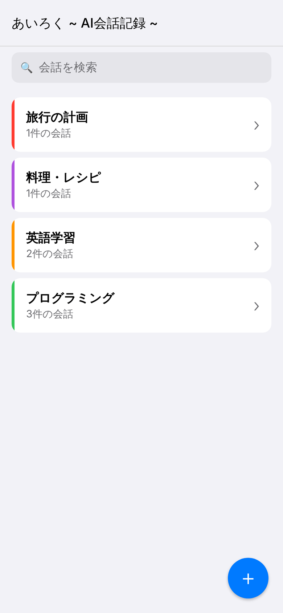
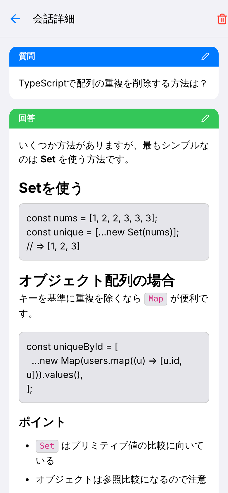
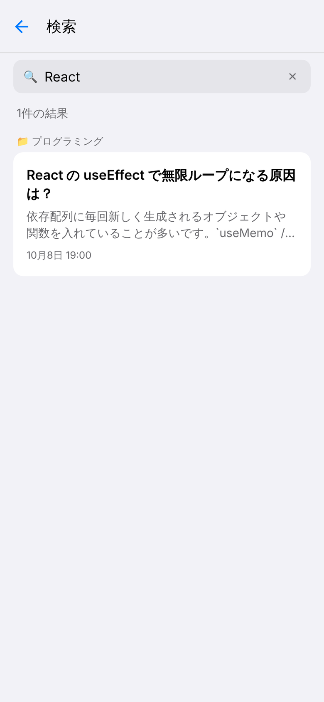

# あいろく ~ AI会話記録 ~

AIへの質問と回答を、iPhoneの中にフォルダで整理して保存できるアプリです。
ChatGPTやClaudeなどで得た「あとで見返したい回答」を、Markdownの見た目そのままで残せます。

## スクリーンショット

| ホーム | 会話詳細 | 検索 |
| :---: | :---: | :---: |
|  |  |  |

## 主な機能

- **フォルダで整理** — テーマごとにフォルダを作成・編集・削除
- **会話の保存** — 質問を入力し、AIの回答をペーストするだけ
- **Markdown表示** — コードブロック、リスト、見出しなどをきれいに表示
- **全文検索** — 質問・回答の両方からキーワードで検索
- **ダークモード対応** — 端末の設定に合わせて自動で切り替え
- **端末内に保存** — データは端末内にのみ保存され、外部には送信されません

## プライバシーポリシー

[プライバシーポリシー](PRIVACY_POLICY.md)をご確認ください。
